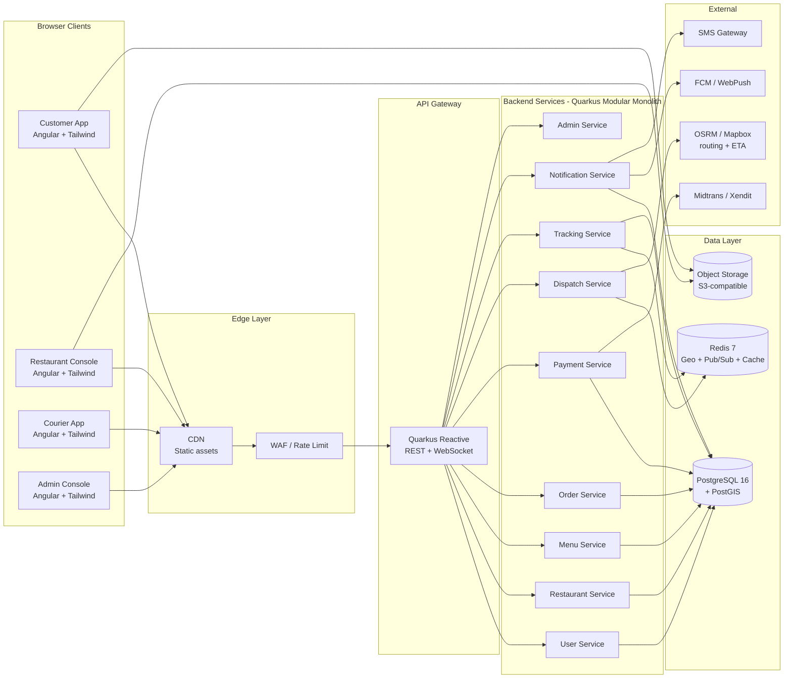
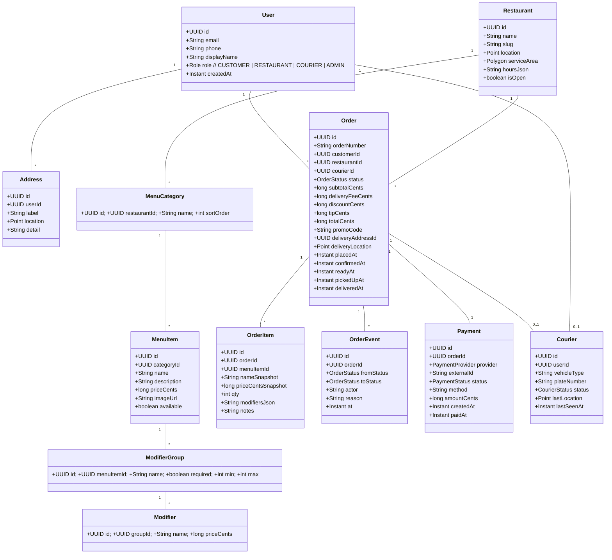
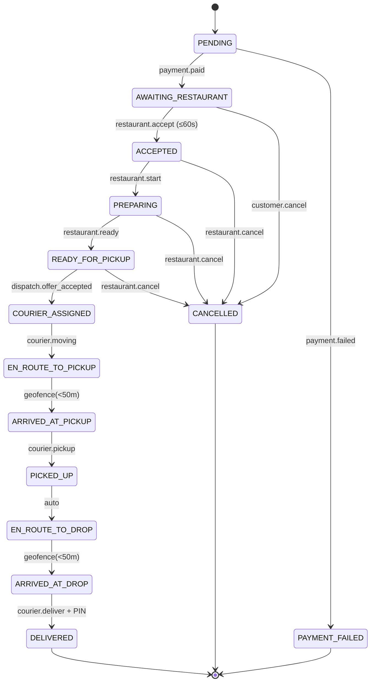
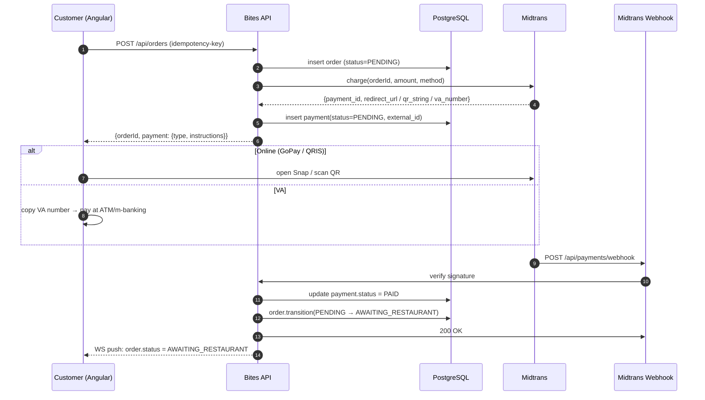

# Product Requirements Document
# Food Order Platform — "Bites"

**Version:** 1.0
**Status:** Draft for review
**Last updated:** 2026-08-29
**Document owner:** Product Team
**Tech stack:** Angular 18 + Tailwind CSS · Quarkus 3 (Java 21) + PostgreSQL 16

---

## Table of Contents

1. [Executive Summary](#1-executive-summary)
2. [Market Research & Competitor Analysis](#2-market-research--competitor-analysis)
3. [Product Vision, Goals & KPIs](#3-product-vision-goals--kpis)
4. [Scope (In / Out)](#4-scope-in--out)
5. [Personas](#5-personas)
6. [User Journeys](#6-user-journeys)
7. [Functional Requirements](#7-functional-requirements)
8. [System Architecture](#8-system-architecture)
9. [Frontend Architecture — Angular + Tailwind](#9-frontend-architecture--angular--tailwind)
10. [Backend Architecture — Quarkus + PostgreSQL](#10-backend-architecture--quarkus--postgresql)
11. [Database Design](#11-database-design)
12. [Order Status State Machine](#12-order-status-state-machine)
13. [Payment Integration](#13-payment-integration)
14. [Real-time Courier Tracking & Map](#14-real-time-courier-tracking--map)
15. [Notifications](#15-notifications)
16. [API Specification](#16-api-specification)
17. [Security & Compliance](#17-security--compliance)
18. [Non-Functional Requirements](#18-non-functional-requirements)
19. [Project Plan & Milestones](#19-project-plan--milestones)
20. [Risks & Open Questions](#20-risks--open-questions)
21. [Glossary](#21-glossary)
22. [Appendices](#22-appendices)

---

## 1. Executive Summary

**Bites** is a multi-restaurant online food ordering platform — web-first, mobile-responsive — that lets customers discover nearby restaurants, customize meals, pay online, and watch their order and courier move on a live map in real time. The system unifies three first-party roles (customer, restaurant operator, courier) and one back-office role (admin) into a single product.

This PRD is the single source of truth for v1.0 and covers:

- Why we are building it (market context and competitor gaps)
- What we are building (functional and non-functional requirements)
- How we are building it (architecture, data model, APIs, integrations)
- When and in what order (milestones, team plan)

**Why now?** Indonesian QSR and casual-dining chains (KFC, McDonald's, Mixue, Kopi Kenangan) have fragmented ordering experiences across their own apps, GoFood, GrabFood, ShopeeFood, and WhatsApp. KFC Indonesia's own ordering site (order.kfcku.co.id) exemplifies the standard: browse menu → cart → online payment → third-party courier dispatch (GoSend, GrabExpress, AntarAja) → passive status text updates. None of them give the **customer a real-time map view of the courier with a live ETA**, and none give the **merchant a unified console** for menu, prep time, and order flow. Bites fills that gap.

**Headline metrics we commit to for v1.0:**

| Metric | Target |
|---|---|
| p95 order-placement latency (excluding payment gateway) | < 500 ms |
| Status push to customer UI | < 2 s after server event |
| Map freshness (last courier position) | < 5 s |
| Order placement → restaurant confirmation | < 60 s median |
| Crash-free sessions | > 99.5% |
| Lighthouse performance score (mobile) | > 85 |

---

## 2. Market Research & Competitor Analysis

We analyzed the four most relevant Indonesian QSR ordering experiences and the canonical Western references (DoorDash, Uber Eats) to derive the requirement set.

### 2.1 KFC Indonesia (order.kfcku.co.id — analyzed in detail)

**What they do well:**

- Service-mode selector on the landing page: **Dine-In · Takeaway · Drive-Thru · Delivery** — a single entry point that splits the flow early and avoids the cart being invalidated by an address change later.
- Restaurant selector with **service-time estimate** ("Ready in 12 min" / "Delivery in 30 min") so the user knows what they are committing to before browsing.
- Persistent menu navigation with **categories and best-sellers** rendered as image tiles, optimized for mobile thumb-tap.
- Item-detail sheet with **mandatory and optional modifiers** (e.g. "Pilih Spicy Level", "Pilih Sauce", "Tambah Topping") grouped into a single accordion — only one scroll to see all options.
- **Save-as-favorite** orders: "Simpan pesanan favorit" lets returning users re-order in 2 taps.
- Account features: order history, KFC membership points, exclusive deals for registered users.
- Online-only payment; cash on delivery is **not** offered (forces payment gateway integration quality up).

**What they do poorly (gaps Bites will close):**

- **No live map view** of the courier — only "Driver is on the way" text and an ETA.
- **No live ETA recalculation** based on courier GPS — ETA is a single number set at dispatch.
- **30-minute SLA** for courier assignment with automatic cancel if no courier accepts; this is a known pain point during peak hours. Bites will pre-dispatch a courier as soon as the order enters `PREPARING` (just-in-time model), and will fall back to a different courier pool.
- Order tracking link is per-order and not shareable; no way for a household to share a single tracking URL.
- No restaurant-side dashboard for menu/inventory updates in the same product — restaurant operators use a separate PoS.

### 2.2 KFC Kuwait (KFCKU App — analyzed from public terms)

- Confirms the same multi-mode flow (Delivery, Pickup, Dine-In, Drive-Thru).
- Terms explicitly state **third-party courier partnerships** (GoSend, GrabExpress, AntarAja) — confirming that even KFC outsources last-mile. Bites must be courier-agnostic.
- SLA: courier assigned within 30 min or auto-cancel. Same gap as KFC Indonesia.
- Legal terms require **contact details of the courier to be shown in the order status** — useful design hint; Bites will show courier name, vehicle type, and a masked phone number (call masking) with explicit consent.

### 2.3 Mixue Indonesia (Mixue Order app)

- Heavy use of **combo deals** and "buy 1 get 1" promos — bundle pricing is critical for the Indonesian market.
- **Minimal item customization** — most items are pre-set combos, which simplifies cart but reduces flexibility.
- **No scheduled orders** for v1, but strong demand in customer feedback.
- Pay-at-counter option alongside QRIS.

### 2.4 McDonald's Indonesia

- **Self-pickup order number** displayed on screen and pushed to the app; user shows the number at the counter. Same pattern as KFC drive-thru.
- Heavy **personalization engine** based on past orders ("Pesan lagi").
- Tight **POS integration** — every online order immediately appears on the kitchen display system (KDS) at the store.

### 2.5 Western references (DoorDash, Uber Eats)

These set the bar for the experience Bites must match:

- **Live courier map** with rotating courier marker, route polyline, and continuously-recalculated ETA.
- **Status stepper** with timestamps and per-step icons at the top of the tracking page.
- **Photo + PIN at delivery** for proof of delivery.
- **In-app chat** between customer and courier (masked phone).
- **Surge pricing** by zone, opaque to the customer.

### 2.6 Synthesis — what Bites must include to be competitive

| Feature | KFC ID | Mixue | McD ID | DoorDash | **Bites v1.0** |
|---|---|---|---|---|---|
| Multi-mode (delivery/pickup/dine-in/drive-thru) | ✅ | partial | ✅ | delivery only | ✅ |
| Item customization | ✅ | ❌ | ✅ | ✅ | ✅ |
| Online payment (QRIS, VA, e-wallet, card) | ✅ | partial | ✅ | n/a | ✅ |
| **Live courier map** | ❌ | ❌ | ❌ | ✅ | **✅** |
| Live ETA recalc | ❌ | ❌ | ❌ | ✅ | **✅** |
| Real-time status push | text only | text | text | WS | **WS** |
| Proof of delivery (photo + PIN) | ❌ | ❌ | ❌ | ✅ | **✅** |
| Customer ↔ courier in-app chat | ❌ | ❌ | ❌ | ✅ | **✅ (v1.1)** |
| Restaurant PoS / KDS integration | external | external | ✅ | ✅ | **KDS-lite (v1.0)** |
| Scheduled / pre-order | ❌ | ❌ | ❌ | ✅ | **✅ (v1.1)** |
| Loyalty / points | ✅ | ❌ | ✅ | ✅ | **✅ (v1.1)** |
| Promo engine (coupons, BxGy, bundles) | ✅ | ✅ | ✅ | ✅ | **✅** |
| Surge pricing | ❌ | ❌ | ❌ | ✅ | **out of v1.0** |
| Multi-language (ID + EN) | ✅ | ✅ | ✅ | ✅ | **✅** |

---

## 3. Product Vision, Goals & KPIs

### 3.1 Vision

> "From craving to doorstep — see every step on the map."

### 3.2 Strategic goals (12-month horizon)

1. **G1 — Become the most-trusted food-ordering experience in Indonesia** by being the only platform that shows the customer the courier on a live map, end-to-end.
2. **G2 — Operate at QSR scale** (10k orders/day per region) without architectural rewrites.
3. **G3 — Reduce merchant operating cost** by giving them a single console for menu, prep-time, and order flow.
4. **G4 — Be courier-agnostic** so we can swap providers (internal fleet, GrabExpress, GoSend, Lalamove, Maxim) without customer-facing changes.

### 3.3 KPIs

| KPI | Baseline (today, no platform) | Target (3 mo) | Target (12 mo) |
|---|---|---|---|
| Average time-to-courier-pickup | manual, opaque | 18 min | 14 min |
| Order completion rate (placed → delivered) | n/a | 96% | 98% |
| Customer support tickets per 1k orders | n/a | 25 | 8 |
| Repeat-order rate (within 30 days) | n/a | 25% | 45% |
| Restaurant onboarding time | weeks | 3 days | 1 day |
| Courier on-time delivery rate | n/a | 88% | 95% |

---

## 4. Scope (In / Out)

### 4.1 In scope for v1.0

- Web-responsive customer app (Angular 18 + Tailwind), no native mobile in v1.0
- Restaurant operator console (web, same Angular monorepo)
- Courier app (web-responsive, **lightweight** — primary target is mobile browser; native app is v1.1)
- Admin back-office (web, Angular)
- Quarkus backend with modular monolith architecture (3 internal modules, one deployable)
- PostgreSQL 16 with PostGIS extension for geo queries
- Payment via Midtrans (primary) and Xendit (secondary, failover)
- Real-time courier tracking on Leaflet + OpenStreetMap (free tier for v1.0; Mapbox/MapLibre switchable for paid tier)
- WebSocket-based status push and courier location fan-out
- QRIS, Virtual Account, GoPay, OVO, DANA, ShopeePay, credit/debit card
- Promo engine: flat discount, percentage, BxGy, free delivery
- Multi-restaurant catalog, single-restaurant cart
- Multi-language: Bahasa Indonesia (default) + English

### 4.2 Out of scope for v1.0 (deferred to v1.1+)

- Native iOS / Android apps
- In-app chat (we use phone-call masking via Twilio/Nexmo in v1.0; chat comes in v1.1)
- Loyalty points and tiered membership
- Scheduled / pre-orders
- Subscriptions ("weekly meal box")
- Group orders and split bill
- Multi-courier dispatch optimization (we start with greedy nearest-courier)
- Dynamic surge pricing
- AI-driven menu recommendations
- Driver earnings wallet & payout
- Integration with restaurant PoS systems beyond CSV menu import

---

## 5. Personas

### 5.1 Primary personas

| Persona | Tag | Description | Primary needs |
|---|---|---|---|
| **Andini** | Hungry Customer | 26, office worker in Jakarta, orders lunch 3x/week, lives on her phone | Speed, see her food coming, pay with QRIS, no surprises |
| **Pak Budi** | Restaurant Owner | 42, owns 3 Ayam Geprek outlets, runs them with his family, not technical | One screen to manage menu, accept orders, control prep time |
| **Rio** | Courier | 24, full-time Gojek driver, picks up Bites orders between GoFood runs | Clear pickup address, easy "I'm here" tap, see how much he'll earn |
| **Sari** | Bites Admin | 31, ops manager, monitors city-wide order health and resolves escalations | Bird's-eye view, drill-down to one order, refund / re-dispatch tools |

### 5.2 Secondary personas

| Persona | Description |
|---|---|
| **Dewi** (Catering Coordinator) | Orders 30 meals for office lunch; needs scheduled delivery, single payment, single receipt |
| **Anton** (Customer Service Rep) | Handles tickets via the admin console; needs order timeline, refund, and re-dispatch buttons |

---

## 6. User Journeys

We document three end-to-end journeys; the rest follow the same shape.

### 6.1 Journey 1 — Andini orders lunch (the money journey)

```
1. Andini lands on bites.co.id → location permission → restaurant list sorted by ETA
2. She picks "Ayam Geprek Pak Budi — Tebet" (12 min delivery)
3. Browses menu (categories, best-sellers) → adds 1 Paket A + 1 Es Teh → cart
4. Customizes: "Pedas level 3, tambah kerupuk" → cart updates live
5. Goes to checkout → selects saved address (auto-detected via geolocation)
6. Chooses QRIS → confirms order → Midtrans Snap popup → scan with GoPay
7. Payment success → order screen with status stepper + "Looking for a courier..." spinner
8. Within 30s: "Restaurant confirmed" + estimated prep time
9. At prep-complete: "Courier on the way to restaurant" — map shows courier approaching
10. Courier picks up: "On the way to you" — map shows courier + customer pin + route polyline + live ETA
11. Courier arrives: notification + courier calls via masked number
12. Delivery confirmed (PIN entered): "Enjoy your meal!" + rating prompt
```

### 6.2 Journey 2 — Pak Budi accepts an order

```
1. Bites tablet at the counter dings
2. Order card shows: items, modifiers, payment status, customer ETA
3. Pak Budi taps "Accept" → status becomes ACCEPTED, prep timer starts
4. He taps "Mark Ready" when food is packed → status READY_FOR_PICKUP
5. Bites dispatches the nearest available courier automatically
6. Courier arrives, Pak Budi hands over the bag, taps "Handover Complete" on tablet
```

### 6.3 Journey 3 — Rio delivers an order

```
1. Rio opens Bites courier app → "Available" toggle ON
2. Bites offers an order: pickup at Ayam Geprek Pak Budi, drop in Tebet, earn Rp 8.000
3. Rio taps "Accept" → order card shows both addresses, customer masked phone
4. Rio taps "Navigate" → Google Maps deep-link opens with the destination
5. On arrival at restaurant: Rio taps "Arrived at restaurant" → restaurant tablet pings
6. Pak Budi hands over the bag; Rio taps "Picked up" → customer gets map update
7. Rio drives to customer → on arrival, taps "Arrived" → customer gets "Your order is here"
8. Customer gives a 4-digit PIN verbally → Rio enters it → "Delivered"
```

---

## 7. Functional Requirements

Requirements are numbered **FR-X.Y** for traceability.

### 7.1 Customer-facing (FR-C)

**Account & Profile**
- **FR-C.1** Register / login via email+password, phone+OTP, or Google OAuth.
- **FR-C.2** Manage saved addresses (home, office, "other") with map-pinned location + label + delivery instructions.
- **FR-C.3** View order history with re-order button per past order.
- **FR-C.4** Manage notification preferences (push, email, SMS per event).
- **FR-C.5** Manage payment methods: saved cards (tokenized via Midtrans), saved e-wallet references.

**Discovery & Menu**
- **FR-C.6** Location detection via browser geolocation API with manual override; store last-known location.
- **FR-C.7** Restaurant list sorted by default distance; filter by cuisine, price, rating, open-now, promo, ETA.
- **FR-C.8** Restaurant detail page: hero image, hours, address with map preview, ETA, menu tabs (categories), best-sellers.
- **FR-C.9** Search across menu items and restaurants.
- **FR-C.10** Item detail with image, description, price, **mandatory** and **optional modifiers** (radio/checkbox), special instructions text.
- **FR-C.11** Availability-aware: out-of-stock items shown but disabled.

**Cart & Checkout**
- **FR-C.12** Cart persists in localStorage and re-hydrates on reload.
- **FR-C.13** Apply promo code; show discount line and final total.
- **FR-C.14** Choose delivery address (or pickup store); service mode switch is allowed only if cart is empty.
- **FR-C.15** Choose payment method (QRIS / VA / e-wallet / card).
- **FR-C.16** Optional tip for courier (preset 5/10/15% + custom).
- **FR-C.17** Order summary: items + modifiers + subtotal + delivery fee + service fee + discount + tip + total.
- **FR-C.18** Place order → receive order ID + redirect to tracking screen.

**Tracking**
- **FR-C.19** Status stepper with timestamps for each state.
- **FR-C.20** Live courier position on map (Leaflet + OSM) once courier is assigned.
- **FR-C.21** Live ETA, recalculated every 30s.
- **FR-C.22** Courier name, vehicle type, masked phone (call button).
- **FR-C.23** Shareable tracking link (read-only, no PII).

**Post-order**
- **FR-C.24** Rating (1–5 stars + optional text) for restaurant, courier, and overall.
- **FR-C.25** Re-order with one tap.
- **FR-C.26** Report a problem (wrong item, late, missing) → ticket created in admin.
- **FR-C.27** Cancel order: allowed before `PREPARING`; refund to original payment method.

### 7.2 Restaurant-facing (FR-R)

- **FR-R.1** Login (email+password or OTP).
- **FR-R.2** Store profile: name, address, hours, photos, contact.
- **FR-R.3** Menu management: CRUD items, categories, modifiers, prices, availability toggles, photo upload.
- **FR-R.4** Real-time order feed: new orders appear within 1s with a sound + visual alert.
- **FR-R.5** Accept / Reject order with reason (≤ 60s SLA; auto-accept on timeout configurable).
- **FR-R.6** Update prep-time estimate (in minutes).
- **FR-R.7** Status updates: ACCEPTED → PREPARING → READY_FOR_PICKUP → HANDED_OVER.
- **FR-R.8** Sales dashboard: today / 7d / 30d, top items, peak hours.
- **FR-R.9** Promo creation (in collaboration with admin): BxGy, percentage, flat.
- **FR-R.10** Set store open/closed, pause new orders temporarily.

### 7.3 Courier-facing (FR-D)

- **FR-D.1** Login + KYC (name, ID photo, vehicle type, plate number, bank account for payout).
- **FR-D.2** Online / Offline toggle; location permissions required when online.
- **FR-D.3** Receive dispatch offer with pickup, drop-off, distance, payout; accept or decline.
- **FR-D.4** Navigate to pickup (deep-link to Google Maps / Waze / Apple Maps).
- **FR-D.5** Status flow: EN_ROUTE_TO_PICKUP → ARRIVED_AT_PICKUP → PICKED_UP → EN_ROUTE_TO_DROP → ARRIVED_AT_DROP → DELIVERED.
- **FR-D.6** GPS heartbeat every 5s while online, every 15s when stationary (speed < 5 km/h).
- **FR-D.7** Customer masked phone (call button only, no PII).
- **FR-D.8** Delivery proof: enter 4-digit PIN supplied by customer; optional photo upload.
- **FR-D.9** Daily earnings summary; weekly payout history.

### 7.4 Admin-facing (FR-A)

- **FR-A.1** Onboard restaurants (KYC, contract, menu CSV import or guided entry).
- **FR-A.2** Onboard couriers (KYC review).
- **FR-A.3** City / zone configuration: serviceable polygons, delivery fee matrix, surge rules.
- **FR-A.4** Promo management: global, restaurant-scoped, user-scoped, time-bound, max-redemptions.
- **FR-A.5** Live operations dashboard: orders/min, avg prep time, courier utilization, stuck orders alert.
- **FR-A.6** Order inspector: full timeline, payments, refunds, re-dispatch.
- **FR-A.7** Manual refund, partial refund, credit-to-wallet.
- **FR-A.8** Customer support: lookup by phone/email, view orders, take action.
- **FR-A.9** Reporting: GMV, commission, top restaurants, fraud signals.

### 7.5 Cross-cutting (FR-X)

- **FR-X.1** Multi-language: `id` (default), `en`.
- **FR-X.2** Time-zone aware (Asia/Jakarta default, WIB/WITA/WIB).
- **FR-X.3** All money fields in IDR with 2-decimal precision; stored as `BIGINT` (rupiah units) to avoid float errors.
- **FR-X.4** All timestamps stored in UTC; rendered in user's locale.
- **FR-X.5** Audit log for every state transition and admin action.
- **FR-X.6** Idempotency keys on all write endpoints to prevent double-submission.

---

## 8. System Architecture

### 8.1 High-level diagram



### 8.2 Architecture style — modular monolith

We deliberately start with a **modular monolith** (single Quarkus deployable, three Maven modules: `app-core`, `app-api`, `app-batch`) instead of microservices:

- **Why monolith first:** at v1.0 we expect 0–5k orders/day per region. Microservices add operational tax (separate deploys, tracing, contracts) that doesn't pay back at this scale.
- **Why modular:** clear package boundaries (`com.bites.order`, `com.bites.payment`, …) with each module exposing a public API and hiding internals. Migrating to microservices later is a packaging change, not a rewrite.
- **Boundary lines:** services communicate **only** through injected interfaces or domain events published to Redis Pub/Sub (later, Kafka). No cross-module SQL.

### 8.3 Why Quarkus for this product

| Decision | Rationale |
|---|---|
| Quarkus over Spring Boot | Fast startup (matters for K8s scale-to-zero), lower memory footprint (better $/request on cloud), native-image option for courier-dispatch service under burst load, first-class support for reactive + imperative within the same app. |
| Imperative Panache for OLTP, Reactive for I/O-bound | Order service is CRUD-heavy → Panache. Tracking service is GPS-stream-heavy → Mutiny + Reactive PG client. |
| Quarkus WebSockets Next | Declarative WebSocket endpoints (`@OnOpen`, `@OnTextMessage`, `@OnClose`) for the tracking channel. |
| Quarkus SmallRye Reactive Messaging | Bridges internal Pub/Sub to outbound webhooks and FCM later. |
| Hibernate ORM + Flyway | Standard JPA for entities, Flyway for versioned migrations — Quarkus boots migrations on startup. |
| SmallRye Health + Metrics | `/q/health` and `/q/metrics` for K8s probes and Prometheus scraping. |

### 8.4 Tech stack summary

| Layer | Choice |
|---|---|
| Frontend framework | Angular 18 (standalone components, signals, new control flow `@if/@for`) |
| Styling | Tailwind CSS 3 + Tailwind UI patterns |
| State (client) | Angular Signals + `signalStore` for cross-component; RxJS for streaming |
| Map | Leaflet 1.9 + OpenStreetMap tiles (v1.0); MapLibre GL (switchable) |
| Real-time | Native WebSocket via RxJS `webSocket()` |
| Backend framework | Quarkus 3.15+ (Java 21) |
| DB | PostgreSQL 16 + PostGIS 3.4 |
| Cache / Pub-Sub | Redis 7 |
| Migrations | Flyway 10 |
| Auth | Quarkus OIDC + JWT (RS256), refresh tokens in httpOnly cookies |
| Payment | Midtrans Snap (primary), Xendit (secondary, failover) |
| Object storage | S3-compatible (AWS S3 or MinIO) |
| Email | SendGrid |
| SMS | Twilio / local provider (e.g. Zenziva) |
| Push | Web Push API (no native app in v1.0) |
| CI/CD | GitHub Actions → Docker → Kubernetes (or container Apps) |
| Observability | OpenTelemetry → Grafana / Loki / Tempo / Prometheus |

---

## 9. Frontend Architecture — Angular + Tailwind

### 9.1 Repo layout (Nx monorepo)

```
bites-web/
├── apps/
│   ├── customer/        # Customer-facing Angular app
│   ├── restaurant/      # Restaurant operator console
│   ├── courier/         # Courier app
│   └── admin/           # Admin back-office
├── libs/
│   ├── shared/          # Common models, types, utils
│   ├── ui/              # Tailwind-styled design system (Button, Card, Modal, …)
│   ├── data-access/     # HTTP services, WebSocket services, signal stores
│   ├── auth/            # Auth lib (login, guards, interceptors)
│   ├── i18n/            # ID + EN translations
│   └── map/             # Leaflet wrapper component
├── tailwind.config.ts
├── nx.json
└── package.json
```

### 9.2 Customer app structure

```
apps/customer/src/app/
├── app.config.ts                 # ApplicationConfig (providers, router, http, i18n)
├── app.routes.ts                 # Standalone route config
├── app.component.ts              # Root layout shell
├── core/                         # Auth, HTTP interceptors, error handling
│   ├── auth/
│   ├── http/
│   └── error/
├── features/
│   ├── home/                     # Restaurant list
│   ├── restaurant/               # Restaurant detail + menu
│   ├── item-detail/              # Item customization
│   ├── cart/                     # Cart drawer + page
│   ├── checkout/                 # Address, payment, confirm
│   ├── tracking/                 # Live order tracking
│   ├── orders/                   # Order history
│   ├── profile/                  # Account settings
│   └── auth/                     # Login, register, OTP
├── shared/                       # Pipes, directives, atoms
└── layout/
    ├── header/
    ├── footer/
    └── bottom-nav/               # Mobile bottom nav
```

### 9.3 State management — Signals first, RxJS where needed

We use **Angular Signals** as the default, with `signalStore` for cross-feature stores. RxJS is reserved for streams (WebSocket, geolocation, HTTP).

**Cart example (signal store):**

```typescript
// libs/data-access/cart.store.ts
import { signalStore, withState, withMethods, withComputed, patchState } from '@ngrx/signals';

type CartState = {
  items: CartItem[];
  promoCode: string | null;
  serviceMode: 'delivery' | 'pickup' | 'dine_in';
  deliveryAddressId: string | null;
};

export const CartStore = signalStore(
  { providedIn: 'root' },
  withState<CartState>({
    items: [],
    promoCode: null,
    serviceMode: 'delivery',
    deliveryAddressId: null,
  }),
  withComputed((store) => ({
    subtotal: computed(() => store.items().reduce((s, i) => s + i.subtotalCents, 0)),
    itemCount: computed(() => store.items().reduce((s, i) => s + i.qty, 0)),
  })),
  withMethods((store) => ({
    addItem(item: CartItem) {
      patchState(store, { items: [...store.items(), item] });
      localStorage.setItem('cart', JSON.stringify(store.items()));
    },
    applyPromo(code: string) { /* ... */ },
    clear() { patchState(store, { items: [] }); },
  }))
);
```

### 9.4 Tailwind config (excerpt)

```typescript
// tailwind.config.ts
import type { Config } from 'tailwindcss';

export default {
  content: ['./apps/**/*.{html,ts}', './libs/**/*.{html,ts}'],
  theme: {
    extend: {
      colors: {
        brand: {
          50:  '#FFF6E5',
          500: '#F97316',  // primary orange
          700: '#C2410C',
        },
        surface: {
          DEFAULT: '#FFFFFF',
          muted:   '#F7F7F8',
        },
        status: {
          pending:    '#A1A1AA',
          confirmed:  '#3B82F6',
          preparing:  '#F59E0B',
          dispatch:   '#8B5CF6',
          delivered:  '#10B981',
          cancelled:  '#EF4444',
        },
      },
      fontFamily: {
        sans: ['"Inter"', 'system-ui', 'sans-serif'],
        display: ['"Plus Jakarta Sans"', 'sans-serif'],
      },
      boxShadow: {
        card: '0 1px 2px rgba(0,0,0,0.04), 0 4px 12px rgba(0,0,0,0.06)',
      },
    },
  },
  plugins: [require('@tailwindcss/forms'), require('@tailwindcss/typography')],
} satisfies Config;
```

### 9.5 Key UI components

| Component | Purpose | Notes |
|---|---|---|
| `RestaurantCard` | List item | Image, name, rating, ETA, delivery fee |
| `MenuItemRow` | Item in menu | Image, name, price, "Tambah" button |
| `ItemCustomizationSheet` | Modal/sheet | Mandatory + optional modifiers, sticky footer with total |
| `CartDrawer` | Slide-in | Items, qty stepper, subtotal, "Lanjut bayar" |
| `ServiceModeSelector` | Top-of-page toggle | Delivery / Pickup / Dine-In |
| `AddressPicker` | Map + saved list | Leaflet pin-drop, search, "Use current location" |
| `PaymentMethodPicker` | Radio group | QRIS, VA, e-wallet, card logos |
| `OrderStatusStepper` | Horizontal stepper | Icons + label + timestamp per stage |
| `LiveMap` | Tracking map | Leaflet, courier marker (rotates), customer marker, route polyline |
| `CourierCard` | Bottom card on map | Avatar, name, vehicle, masked phone, "Chat" (v1.1) |
| `RatingSheet` | Post-delivery | 1–5 stars per role + optional comment |

### 9.6 Routing strategy

```typescript
// app.routes.ts
import { Routes } from '@angular/router';
import { authGuard } from '@bites/auth';

export const routes: Routes = [
  { path: '', loadComponent: () => import('./features/home/home.page').then(m => m.HomePage) },
  { path: 'r/:slug', loadComponent: () => import('./features/restaurant/restaurant.page').then(m => m.RestaurantPage) },
  { path: 'item/:id', loadComponent: () => import('./features/item-detail/item-detail.page').then(m => m.ItemDetailPage) },
  { path: 'cart', loadComponent: () => import('./features/cart/cart.page').then(m => m.CartPage) },
  { path: 'checkout', canActivate: [authGuard], loadComponent: () => import('./features/checkout/checkout.page').then(m => m.CheckoutPage) },
  { path: 'orders', canActivate: [authGuard], loadComponent: () => import('./features/orders/orders.page').then(m => m.OrdersPage) },
  { path: 'orders/:id/tracking', canActivate: [authGuard], loadComponent: () => import('./features/tracking/tracking.page').then(m => m.TrackingPage) },
  { path: 'profile', canActivate: [authGuard], loadComponent: () => import('./features/profile/profile.page').then(m => m.ProfilePage) },
  { path: 'auth/login', loadComponent: () => import('./features/auth/login.page').then(m => m.LoginPage) },
  { path: '**', redirectTo: '' },
];
```

All routes are **standalone, lazy-loaded** for fast first paint.

### 9.7 WebSocket client (tracking)

```typescript
// libs/data-access/tracking.service.ts
@Injectable({ providedIn: 'root' })
export class TrackingService {
  private socket$?: WebSocketSubject<TrackingEvent>;

  connect(orderId: string, token: string): Observable<TrackingEvent> {
    if (this.socket$) return this.socket$.asObservable();
    const url = `${environment.wsUrl}/tracking/${orderId}?token=${token}`;
    this.socket$ = webSocket<TrackingEvent>({
      url,
      openObserver: { next: () => console.log('WS open') },
      closeObserver: { next: () => setTimeout(() => this.connect(orderId, token), 2000) },
    });
    return this.socket$.asObservable();
  }
}
```

### 9.8 Performance budget

| Asset | Budget |
|---|---|
| Initial JS (gzipped) | < 180 KB |
| LCP | < 2.5s on 4G mobile |
| TTI | < 3.5s on 4G mobile |
| Map tile cache hit | > 80% (use IndexedDB tile cache via Leaflet.offline) |

---

## 10. Backend Architecture — Quarkus + PostgreSQL

### 10.1 Repo layout

```
bites-api/
├── pom.xml                         # parent POM
├── bites-core/                     # domain (entities, value objects, services)
│   └── src/main/java/com/bites/core/
│       ├── order/
│       ├── restaurant/
│       ├── menu/
│       ├── user/
│       ├── payment/
│       ├── dispatch/
│       ├── tracking/
│       └── notification/
├── bites-api/                      # REST resources, DTOs, mappers
│   └── src/main/java/com/bites/api/
│       ├── rest/                   # @Path resources
│       ├── ws/                     # WebSocket endpoints
│       └── dto/
├── bites-batch/                    # scheduled jobs (reconcile, payouts)
│   └── src/main/java/com/bites/batch/
├── bites-app/                      # executable (assembles the three modules)
│   └── src/main/
│       ├── java/com/bites/
│       │   └── BitesApplication.java
│       └── resources/
│           ├── application.properties
│           └── db/migration/       # Flyway scripts
└── docker/
    ├── Dockerfile
    └── docker-compose.yml          # local dev: postgres, postgis, redis, minio, mailhog
```

### 10.2 Maven modules — `pom.xml` (parent)

```xml
<modules>
  <module>bites-core</module>
  <module>bites-api</module>
  <module>bites-batch</module>
  <module>bites-app</module>
</modules>
```

### 10.3 Key Quarkus extensions

```xml
<dependency>
  <groupId>io.quarkus</groupId>
  <artifactId>quarkus-resteasy-reactive-jackson</artifactId>
</dependency>
<dependency>
  <groupId>io.quarkus</groupId>
  <artifactId>quarkus-hibernate-orm-panache</artifactId>
</dependency>
<dependency>
  <groupId>io.quarkus</groupId>
  <artifactId>quarkus-jdbc-postgresql</artifactId>
</dependency>
<dependency>
  <groupId>io.quarkus</groupId>
  <artifactId>quarkus-flyway</artifactId>
</dependency>
<dependency>
  <groupId>io.quarkus</groupId>
  <artifactId>quarkus-redis-client</artifactId>
</dependency>
<dependency>
  <groupId>io.quarkus</groupId>
  <artifactId>quarkus-websockets-next</artifactId>
</dependency>
<dependency>
  <groupId>io.quarkus</groupId>
  <artifactId>quarkus-smallrye-jwt</artifactId>
</dependency>
<dependency>
  <groupId>io.quarkus</groupId>
  <artifactId>quarkus-smallrye-health</artifactId>
</dependency>
<dependency>
  <groupId>io.quarkus</groupId>
  <artifactId>quarkus-micrometer-registry-prometheus</artifactId>
</dependency>
<dependency>
  <groupId>io.quarkus</groupId>
  <artifactId>quarkus-scheduler</artifactId>
</dependency>
<dependency>
  <groupId>io.quarkus</groupId>
  <artifactId>quarkus-opentelemetry</artifactId>
</dependency>
```

### 10.4 `application.properties` (excerpt)

```properties
# Datasource
quarkus.datasource.db-kind=postgresql
quarkus.datasource.username=${DB_USER}
quarkus.datasource.password=${DB_PASSWORD}
quarkus.datasource.jdbc.url=jdbc:postgresql://${DB_HOST:localhost}:5432/bites
quarkus.datasource.jdbc.max-size=20

# Hibernate
quarkus.hibernate-orm.database.generation=validate
quarkus.hibernate-orm.log.sql=false
quarkus.hibernate-orm.physical-naming-strategy=org.hibernate.boot.model.naming.CamelCaseToUnderscoresNamingStrategy

# Flyway
quarkus.flyway.migrate-at-start=true
quarkus.flyway.locations=classpath:db/migration
quarkus.flyway.baseline-on-migrate=true

# Redis
quarkus.redis.hosts=redis://${REDIS_HOST:localhost}:6379

# HTTP
quarkus.http.port=8080
quarkus.http.cors=true
quarkus.http.cors.origins=https://bites.co.id,https://admin.bites.co.id

# JWT
mp.jwt.verify.publickey.location=publicKey.pem
mp.jwt.verify.issuer=https://auth.bites.co.id
smallrye.jwt.sign.key.location=privateKey.pem

# Midtrans
bites.payment.midtrans.server-key=${MIDTRANS_SERVER_KEY}
bites.payment.midtrans.client-key=${MIDTRANS_CLIENT_KEY}
bites.payment.midtrans.is-production=false
bites.payment.midtrans.webhook-url=https://api.bites.co.id/api/payments/webhook

# Tracking WebSocket
bites.tracking.ws.path=/tracking
bites.tracking.location.flush-ms=1000

# Scheduling
bites.dispatch.sla-seconds=30
bites.tracking.stale-threshold-seconds=30

# Logging
quarkus.log.console.json=true
quarkus.log.level=INFO
quarkus.log.category."com.bites".level=DEBUG
```

### 10.5 Domain model overview



### 10.6 Service layer pattern

Each domain module follows the same structure:

```
com.bites.order/
  api/           # public interfaces (OrderService, OrderRepository)
  internal/      # package-private implementations
  domain/        # entities, value objects, enums, domain events
  events/        # outbox records, event publishers
```

**Order service skeleton:**

```java
@ApplicationScoped
public class OrderServiceImpl implements OrderService {

  @Inject OrderRepository repo;
  @Inject PaymentService paymentService;
  @Inject EventBus events;
  @Inject Clock clock;

  @Transactional
  public Order placeOrder(PlaceOrderCommand cmd) {
    var order = Order.draft(cmd.customerId(), cmd.restaurantId(), cmd.items(), cmd.address());
    order.recalculateTotals();
    repo.persist(order);
    events.publish(new OrderPlacedEvent(order.id(), clock.instant()));
    return order;
  }

  public void transition(UUID orderId, OrderStatus to, String actor, String reason) {
    var order = repo.findById(orderId).orElseThrow();
    if (!order.canTransitionTo(to)) {
      throw new IllegalStateTransitionException(order.status(), to);
    }
    order.applyTransition(to, actor, reason, clock.instant());
    repo.persist(order);
    events.publish(new OrderStatusChangedEvent(order.id(), to, clock.instant()));
  }
}
```

### 10.7 Outbox pattern for events

```java
@ApplicationScoped
public class OutboxPoller {

  @Inject OutboxRepository outbox;
  @Inject @ConfigProperty(name="bites.outbox.batch-size", defaultValue="100") int batchSize;
  @Scheduled(every = "1s")
  public void flush() {
    List<OutboxRecord> batch = outbox.fetchUnpublished(batchSize);
    batch.forEach(r -> {
      redisPub.publish(r.topic(), r.payload());
      r.markPublished();
    });
  }
}
```

This guarantees **at-least-once delivery** of events to Redis Pub/Sub without 2-phase commit between DB and broker.

### 10.8 WebSocket endpoint (tracking)

```java
@WebSocket(path = "/tracking/{orderId}")
public class TrackingSocket {

  @Inject TrackingHub hub;
  @Inject JwtParser jwt;

  @OnOpen
  public void onOpen(WebSocketConnection conn, @PathParam("orderId") String orderId) {
    String token = conn.handshakeRequest().getQueryParameter("token");
    UserPrincipal user = jwt.parse(token);
    hub.subscribe(orderId, user.id(), conn);
  }

  @OnClose
  public void onClose(WebSocketConnection conn) {
    hub.unsubscribe(conn);
  }
}

@ApplicationScoped
public class TrackingHub {
  // in-memory map: orderId -> set of connections
  // on each courier location update, fan out
  public void broadcastLocation(String orderId, GeoPoint p, Instant ts) { ... }
}
```

### 10.9 Caching strategy

| Data | Cache |
|---|---|
| Restaurant list per zone | Redis (TTL 60s) |
| Menu of a restaurant | Redis (TTL 5m, invalidate on update) |
| Order lookup by id | None (DB) — source of truth |
| Courier last known location | Redis GEO + hot key |
| Promo code validation | Redis (TTL 30s after first lookup) |
| Auth session | Redis (JWT refresh) |

---

## 11. Database Design

### 11.1 Conventions

- All ids are `UUID` (PostgreSQL `uuid`).
- All money is `BIGINT` storing **rupiah** (smallest unit). Never `NUMERIC` for hot columns to keep indexes fast.
- All timestamps are `TIMESTAMPTZ` stored in UTC.
- Soft-delete via `deleted_at TIMESTAMPTZ NULL`.
- Every mutable table has `created_at`, `updated_at`.
- Use **PostGIS** `geography(Point, 4326)` for any lat/lng column used in geo queries.

### 11.2 Tables (key subset)

```sql
-- Enable extensions
CREATE EXTENSION IF NOT EXISTS "uuid-ossp";
CREATE EXTENSION IF NOT EXISTS postgis;
CREATE EXTENSION IF NOT EXISTS pg_trgm;  -- for fuzzy restaurant search

-- Users
CREATE TABLE users (
  id              UUID PRIMARY KEY DEFAULT uuid_generate_v4(),
  email           CITEXT UNIQUE,
  phone           VARCHAR(20) UNIQUE,
  display_name    VARCHAR(120) NOT NULL,
  password_hash   VARCHAR(255),    -- nullable for OAuth-only
  role            VARCHAR(20) NOT NULL CHECK (role IN ('CUSTOMER','RESTAURANT_OWNER','COURIER','ADMIN')),
  locale          VARCHAR(5) NOT NULL DEFAULT 'id',
  created_at      TIMESTAMPTZ NOT NULL DEFAULT now(),
  updated_at      TIMESTAMPTZ NOT NULL DEFAULT now(),
  deleted_at      TIMESTAMPTZ
);
CREATE INDEX idx_users_phone ON users(phone) WHERE deleted_at IS NULL;

-- Addresses
CREATE TABLE addresses (
  id              UUID PRIMARY KEY DEFAULT uuid_generate_v4(),
  user_id         UUID NOT NULL REFERENCES users(id),
  label           VARCHAR(40) NOT NULL,    -- Home, Office, etc.
  detail          TEXT NOT NULL,           -- street, building, floor, notes
  location        geography(Point, 4326) NOT NULL,
  is_default      BOOLEAN NOT NULL DEFAULT false,
  created_at      TIMESTAMPTZ NOT NULL DEFAULT now()
);
CREATE INDEX idx_addresses_user ON addresses(user_id);
CREATE INDEX idx_addresses_loc ON addresses USING GIST(location);

-- Restaurants
CREATE TABLE restaurants (
  id              UUID PRIMARY KEY DEFAULT uuid_generate_v4(),
  owner_id        UUID NOT NULL REFERENCES users(id),
  name            VARCHAR(120) NOT NULL,
  slug            VARCHAR(140) UNIQUE NOT NULL,
  description     TEXT,
  phone           VARCHAR(20),
  address_detail  TEXT NOT NULL,
  location        geography(Point, 4326) NOT NULL,
  service_area    geography(MultiPolygon, 4326),   -- optional service polygon
  hours_json      JSONB NOT NULL,                  -- {mon:[{open:"09:00",close:"22:00"}], ...}
  is_open         BOOLEAN NOT NULL DEFAULT false,
  rating_avg      NUMERIC(3,2) DEFAULT 0,
  rating_count    INT NOT NULL DEFAULT 0,
  avg_prep_min    INT NOT NULL DEFAULT 15,
  is_active       BOOLEAN NOT NULL DEFAULT true,
  created_at      TIMESTAMPTZ NOT NULL DEFAULT now(),
  updated_at      TIMESTAMPTZ NOT NULL DEFAULT now()
);
CREATE INDEX idx_restaurants_loc ON restaurants USING GIST(location);
CREATE INDEX idx_restaurants_open ON restaurants(is_open) WHERE is_active;

-- Menu
CREATE TABLE menu_categories (
  id              UUID PRIMARY KEY DEFAULT uuid_generate_v4(),
  restaurant_id   UUID NOT NULL REFERENCES restaurants(id) ON DELETE CASCADE,
  name            VARCHAR(80) NOT NULL,
  sort_order      INT NOT NULL DEFAULT 0,
  is_active       BOOLEAN NOT NULL DEFAULT true
);

CREATE TABLE menu_items (
  id              UUID PRIMARY KEY DEFAULT uuid_generate_v4(),
  category_id     UUID NOT NULL REFERENCES menu_categories(id) ON DELETE CASCADE,
  name            VARCHAR(160) NOT NULL,
  description     TEXT,
  price_cents     BIGINT NOT NULL CHECK (price_cents >= 0),
  image_url       TEXT,
  available       BOOLEAN NOT NULL DEFAULT true,
  is_bestseller   BOOLEAN NOT NULL DEFAULT false,
  sort_order      INT NOT NULL DEFAULT 0,
  created_at      TIMESTAMPTZ NOT NULL DEFAULT now(),
  updated_at      TIMESTAMPTZ NOT NULL DEFAULT now()
);
CREATE INDEX idx_menu_items_category ON menu_items(category_id);

CREATE TABLE modifier_groups (
  id              UUID PRIMARY KEY DEFAULT uuid_generate_v4(),
  menu_item_id    UUID NOT NULL REFERENCES menu_items(id) ON DELETE CASCADE,
  name            VARCHAR(80) NOT NULL,
  required        BOOLEAN NOT NULL DEFAULT false,
  min_select      INT NOT NULL DEFAULT 0,
  max_select      INT NOT NULL DEFAULT 1,
  sort_order      INT NOT NULL DEFAULT 0
);

CREATE TABLE modifiers (
  id              UUID PRIMARY KEY DEFAULT uuid_generate_v4(),
  group_id        UUID NOT NULL REFERENCES modifier_groups(id) ON DELETE CASCADE,
  name            VARCHAR(80) NOT NULL,
  price_cents     BIGINT NOT NULL DEFAULT 0,
  available       BOOLEAN NOT NULL DEFAULT true
);

-- Orders
CREATE TABLE orders (
  id                    UUID PRIMARY KEY DEFAULT uuid_generate_v4(),
  order_number          VARCHAR(20) UNIQUE NOT NULL,    -- human-friendly: BIT-20260829-000123
  customer_id           UUID NOT NULL REFERENCES users(id),
  restaurant_id         UUID NOT NULL REFERENCES restaurants(id),
  courier_id            UUID REFERENCES users(id),
  status                VARCHAR(30) NOT NULL,
  service_mode          VARCHAR(20) NOT NULL,           -- DELIVERY | PICKUP | DINE_IN
  subtotal_cents        BIGINT NOT NULL,
  delivery_fee_cents    BIGINT NOT NULL DEFAULT 0,
  service_fee_cents     BIGINT NOT NULL DEFAULT 0,
  discount_cents        BIGINT NOT NULL DEFAULT 0,
  tip_cents             BIGINT NOT NULL DEFAULT 0,
  total_cents           BIGINT NOT NULL,
  promo_code            VARCHAR(40),
  delivery_address_id   UUID REFERENCES addresses(id),
  delivery_location     geography(Point, 4326),
  delivery_notes        TEXT,
  placed_at             TIMESTAMPTZ NOT NULL DEFAULT now(),
  confirmed_at          TIMESTAMPTZ,
  ready_at              TIMESTAMPTZ,
  picked_up_at          TIMESTAMPTZ,
  delivered_at          TIMESTAMPTZ,
  cancelled_at          TIMESTAMPTZ,
  cancel_reason         TEXT,
  estimated_delivery_at TIMESTAMPTZ,
  created_at            TIMESTAMPTZ NOT NULL DEFAULT now(),
  updated_at            TIMESTAMPTZ NOT NULL DEFAULT now()
);
CREATE INDEX idx_orders_customer ON orders(customer_id, placed_at DESC);
CREATE INDEX idx_orders_restaurant ON orders(restaurant_id, placed_at DESC);
CREATE INDEX idx_orders_status_placed ON orders(status, placed_at) WHERE status NOT IN ('DELIVERED','CANCELLED');
CREATE INDEX idx_orders_courier ON orders(courier_id) WHERE courier_id IS NOT NULL;

-- Order items
CREATE TABLE order_items (
  id                    UUID PRIMARY KEY DEFAULT uuid_generate_v4(),
  order_id              UUID NOT NULL REFERENCES orders(id) ON DELETE CASCADE,
  menu_item_id          UUID NOT NULL REFERENCES menu_items(id),
  name_snapshot         VARCHAR(160) NOT NULL,
  price_cents_snapshot  BIGINT NOT NULL,
  qty                   INT NOT NULL CHECK (qty > 0),
  modifiers_json        JSONB,                          -- [{groupId, modifierId, name, priceCents}, ...]
  notes                 TEXT,
  line_subtotal_cents   BIGINT NOT NULL
);
CREATE INDEX idx_order_items_order ON order_items(order_id);

-- Order events (audit + timeline)
CREATE TABLE order_events (
  id            UUID PRIMARY KEY DEFAULT uuid_generate_v4(),
  order_id      UUID NOT NULL REFERENCES orders(id) ON DELETE CASCADE,
  from_status   VARCHAR(30),
  to_status     VARCHAR(30) NOT NULL,
  actor         VARCHAR(20) NOT NULL,    -- SYSTEM | CUSTOMER | RESTAURANT | COURIER | ADMIN
  actor_id      UUID,
  reason        TEXT,
  metadata      JSONB,
  at            TIMESTAMPTZ NOT NULL DEFAULT now()
);
CREATE INDEX idx_order_events_order ON order_events(order_id, at);

-- Payments
CREATE TABLE payments (
  id              UUID PRIMARY KEY DEFAULT uuid_generate_v4(),
  order_id        UUID NOT NULL REFERENCES orders(id),
  provider        VARCHAR(20) NOT NULL,    -- MIDTRANS | XENDIT
  external_id     VARCHAR(120),
  method          VARCHAR(40),             -- QRIS | VA_BCA | GOPAY | CC
  status          VARCHAR(20) NOT NULL,    -- PENDING | PAID | FAILED | EXPIRED | REFUNDED
  amount_cents    BIGINT NOT NULL,
  fee_cents       BIGINT DEFAULT 0,
  raw_response    JSONB,
  created_at      TIMESTAMPTZ NOT NULL DEFAULT now(),
  paid_at         TIMESTAMPTZ,
  expired_at      TIMESTAMPTZ
);
CREATE INDEX idx_payments_order ON payments(order_id);
CREATE UNIQUE INDEX uq_payments_external ON payments(provider, external_id) WHERE external_id IS NOT NULL;

-- Couriers
CREATE TABLE couriers (
  id              UUID PRIMARY KEY DEFAULT uuid_generate_v4(),
  user_id         UUID NOT NULL UNIQUE REFERENCES users(id),
  vehicle_type    VARCHAR(20) NOT NULL,    -- MOTOR | MOBIL | SEPEDA
  plate_number    VARCHAR(20),
  id_photo_url    TEXT,
  status          VARCHAR(20) NOT NULL DEFAULT 'OFFLINE',  -- OFFLINE | AVAILABLE | BUSY
  kyc_status      VARCHAR(20) NOT NULL DEFAULT 'PENDING', -- PENDING | APPROVED | REJECTED
  rating_avg      NUMERIC(3,2) DEFAULT 0,
  rating_count    INT NOT NULL DEFAULT 0,
  bank_account    JSONB,                   -- {bank, accountNo, accountName}
  approved_at     TIMESTAMPTZ
);

-- Promo codes
CREATE TABLE promo_codes (
  id                  UUID PRIMARY KEY DEFAULT uuid_generate_v4(),
  code                VARCHAR(40) UNIQUE NOT NULL,
  type                VARCHAR(20) NOT NULL,    -- PERCENT | FLAT | FREEDELIVERY | BXGY
  value               BIGINT,                 -- percent basis points or cents
  max_discount_cents  BIGINT,
  min_order_cents     BIGINT NOT NULL DEFAULT 0,
  restaurant_id       UUID REFERENCES restaurants(id),  -- null = global
  starts_at           TIMESTAMPTZ NOT NULL,
  ends_at             TIMESTAMPTZ NOT NULL,
  max_redemptions     INT,
  redeemed_count      INT NOT NULL DEFAULT 0,
  is_active           BOOLEAN NOT NULL DEFAULT true
);

-- Idempotency
CREATE TABLE idempotency_keys (
  key             VARCHAR(120) PRIMARY KEY,
  user_id         UUID NOT NULL,
  method          VARCHAR(10) NOT NULL,
  path            VARCHAR(200) NOT NULL,
  request_hash    VARCHAR(64) NOT NULL,
  response_status INT,
  response_body   JSONB,
  created_at      TIMESTAMPTZ NOT NULL DEFAULT now(),
  expires_at      TIMESTAMPTZ NOT NULL
);
CREATE INDEX idx_idempotency_expires ON idempotency_keys(expires_at);

-- Outbox
CREATE TABLE outbox (
  id            UUID PRIMARY KEY DEFAULT uuid_generate_v4(),
  topic         VARCHAR(120) NOT NULL,
  aggregate_id  UUID NOT NULL,
  payload       JSONB NOT NULL,
  created_at    TIMESTAMPTZ NOT NULL DEFAULT now(),
  published_at  TIMESTAMPTZ
);
CREATE INDEX idx_outbox_unpublished ON outbox(created_at) WHERE published_at IS NULL;
```

### 11.3 Index strategy summary

| Query | Index |
|---|---|
| Restaurant list near user | GIST on `restaurants.location` + partial `is_open=true` |
| Customer order history | `(customer_id, placed_at DESC)` |
| Active orders by restaurant | partial `WHERE status NOT IN ('DELIVERED','CANCELLED')` |
| Courier assignment lookup | GIST on `couriers.location` (Redis, but DB for cold queries) |
| Promo validation | unique on `code` + `is_active` partial |
| Payment webhook idempotency | unique on `(provider, external_id)` |

---

## 12. Order Status State Machine

This is the **core** of the system. Every transition is validated server-side, appended to `order_events`, and broadcast over WebSocket.

### 12.1 States

| State | Owner | Description |
|---|---|---|
| `PENDING` | System | Order created, payment not yet captured |
| `PAYMENT_FAILED` | System | Terminal failure (no money taken) |
| `AWAITING_RESTAURANT` | System | Payment captured, waiting for restaurant to accept |
| `ACCEPTED` | Restaurant | Restaurant accepted, will start preparing |
| `PREPARING` | Restaurant | Kitchen is working on it |
| `READY_FOR_PICKUP` | Restaurant | Food is packed, courier needed |
| `COURIER_ASSIGNED` | Dispatch | Courier accepted the offer, heading to restaurant |
| `EN_ROUTE_TO_PICKUP` | Courier | Courier traveling to restaurant |
| `ARRIVED_AT_PICKUP` | Courier | Courier at restaurant |
| `PICKED_UP` | Courier | Courier has the food |
| `EN_ROUTE_TO_DROP` | Courier | Courier heading to customer |
| `ARRIVED_AT_DROP` | Courier | Courier at customer location |
| `DELIVERED` | Courier | PIN verified, proof-of-delivery captured |
| `CANCELLED` | System | Terminal; refund flow may follow |

### 12.2 Transition matrix

| From | To | Allowed actor | Notes |
|---|---|---|---|
| PENDING | AWAITING_RESTAURANT | System (after `payment.paid`) | Webhook from Midtrans |
| PENDING | PAYMENT_FAILED | System (after `payment.failed/expired`) | |
| AWAITING_RESTAURANT | ACCEPTED | Restaurant | 60s SLA, else auto-accept configurable |
| AWAITING_RESTAURANT | CANCELLED | Restaurant / Customer | Customer only if restaurant hasn't accepted |
| ACCEPTED | PREPARING | Restaurant | |
| PREPARING | READY_FOR_PICKUP | Restaurant | Triggers dispatch |
| READY_FOR_PICKUP | COURIER_ASSIGNED | Dispatch | Within 30s SLA |
| COURIER_ASSIGNED | EN_ROUTE_TO_PICKUP | System (on first GPS ping moving toward restaurant) | |
| EN_ROUTE_TO_PICKUP | ARRIVED_AT_PICKUP | Courier (geofence < 50m of restaurant) | |
| ARRIVED_AT_PICKUP | PICKED_UP | Courier (manual tap or QR scan) | |
| PICKED_UP | EN_ROUTE_TO_DROP | System | |
| EN_ROUTE_TO_DROP | ARRIVED_AT_DROP | Courier (geofence < 50m of customer) | |
| ARRIVED_AT_DROP | DELIVERED | Courier (PIN match) | |
| any pre-`PICKED_UP` | CANCELLED | Customer / Restaurant / Admin (with reason) | Refund rules apply |
| DELIVERED, CANCELLED, PAYMENT_FAILED | (terminal) | — | No further transitions |

### 12.3 State diagram



### 12.4 Cancellation & refund rules

| Order status at cancel | Refund |
|---|---|
| PENDING / AWAITING_RESTAURANT | 100% refund (no payment captured) |
| ACCEPTED | 100% refund, restaurant may be charged cancellation fee |
| PREPARING | 50% refund, restaurant compensated for prep |
| READY_FOR_PICKUP | 50% refund, courier compensated if dispatched |
| COURIER_ASSIGNED and later | Not customer-cancellable (admin-only with reason) |

Refunds are processed asynchronously through the same payment gateway.

### 12.5 Implementation

```java
public class Order {
  public boolean canTransitionTo(OrderStatus to) {
    return VALID_TRANSITIONS.getOrDefault(this.status, Set.of()).contains(to);
  }
  public void applyTransition(OrderStatus to, String actor, String reason, Instant at) {
    if (!canTransitionTo(to)) throw new IllegalStateTransitionException(this.status, to);
    this.status = to;
    // set status-specific timestamps
    switch (to) {
      case ACCEPTED -> confirmedAt = at;
      case READY_FOR_PICKUP -> readyAt = at;
      case PICKED_UP -> pickedUpAt = at;
      case DELIVERED -> deliveredAt = at;
      case CANCELLED -> { cancelledAt = at; cancelReason = reason; }
    }
  }
}
```

---

## 13. Payment Integration

### 13.1 Provider choice

| Provider | Strengths | Used for |
|---|---|---|
| **Midtrans (primary)** | Native GoPay redirect, Snap popup, official PHP/Java SDK, sandbox friendly, dashboard reports | All payment methods in v1.0 |
| **Xendit (secondary)** | Clean REST API, programmatic refund, payout API for couriers (v1.1) | Failover, future payouts |

**Fee comparison (Indonesia, 2026):**

| Method | Midtrans | Xendit |
|---|---|---|
| Virtual Account | ~ IDR 4,000 flat | ~ IDR 4,000 flat |
| QRIS | 0.7% (BI-regulated) | 0.7% (BI-regulated) |
| GoPay | Native redirect, 2.0% | QRIS only, 0.7% |
| Credit card | 2.9% + IDR 2,000 | 2.9% + IDR 2,000 |
| OVO / DANA / ShopeePay | 3.0% | 2.9% |

### 13.2 Payment methods supported in v1.0

- **QRIS** (all e-wallets + mobile banking)
- **Virtual Account** (BCA, BNI, BRI, Mandiri, Permata, CIMB)
- **GoPay** (via Midtrans Snap redirect)
- **OVO** (via Midtrans)
- **DANA** (via Midtrans)
- **ShopeePay** (via Midtrans)
- **Credit / debit card** (Visa, MasterCard, JCB, AMEX)

### 13.3 Payment flow



### 13.4 Idempotency & webhooks

- Every webhook from Midtrans is **idempotent** on `(provider, external_id)`.
- The webhook handler verifies the **signature** using Midtrans' SHA-512 with our server key.
- Out-of-order events (e.g. `settlement` arriving before `capture`): the handler applies them in a state machine and only writes the highest-known status.

### 13.5 Service code sketch

```java
@ApplicationScoped
public class MidtransClient {
  @ConfigProperty(name="bites.payment.midtrans.server-key") String serverKey;
  @ConfigProperty(name="bites.payment.midtrans.is-production") boolean isProduction;
  @Inject HttpClient client;

  public ChargeResponse charge(ChargeRequest req) {
    var auth = Base64.getEncoder().encodeToString(serverKey.getBytes());
    return client.post(isProduction ? "https://api.midtrans.com" : "https://api.sandbox.midtrans.com")
      .path("/v2/charge")
      .header("Authorization", "Basic " + auth)
      .body(req)
      .retrieve()
      .body(ChargeResponse.class);
  }
}
```

### 13.6 Refund flow

```java
@Path("/api/payments/{paymentId}/refund")
public class RefundResource {
  @Inject PaymentService payments;
  @POST
  @RolesAllowed("ADMIN")
  public RefundResponse refund(@PathParam("paymentId") UUID id,
                               @QueryParam("amountCents") Long amountCents,
                               @QueryParam("reason") String reason) {
    return payments.refund(id, amountCents, reason, security.getUserId());
  }
}
```

Refunds are async — the response returns a `refund_id` and the admin UI subscribes to its status via polling (or WS push in v1.1).

---

## 14. Real-time Courier Tracking & Map

### 14.1 Pipeline

```mermaid
flowchart LR
    C[Courier browser<br/>Geolocation API<br/>watchPosition] -->|every 5–15s| WS1[WS /courier/location]
    WS1 --> HUB[Tracking Hub<br/>Quarkus]
    HUB -->|GEOADD| RED[(Redis<br/>GEO key: couriers:active)]
    HUB -->|update| PG[(PostgreSQL<br/>courier_locations history)]
    HUB -->|broadcast| WS2[WS /tracking/{orderId}]
    WS2 -->|frame| U[Customer browser<br/>Leaflet marker]
    HUB -->|ETA calc| ETA[ETA Service<br/>OSRM call]
    ETA -->|push every 30s| U
    HUB -->|geofence| GF[Geofence Engine]
    GF -->|order.transition| OS[Order Service]
```

### 14.2 Courier GPS upload

```typescript
// courier app
navigator.geolocation.watchPosition(
  pos => {
    socket.send(JSON.stringify({
      type: 'location',
      lat: pos.coords.latitude,
      lng: pos.coords.longitude,
      speed: pos.coords.speed,        // m/s
      heading: pos.coords.heading,
      accuracy: pos.coords.accuracy,
      ts: Date.now(),
    }));
  },
  err => console.error(err),
  { enableHighAccuracy: true, maximumAge: 2000, timeout: 10000 }
);
```

### 14.3 Server-side: Redis GEO + fan-out

```java
@WebSocket(path = "/courier/location")
public class CourierLocationSocket {

  @Inject RedisDataSource redis;
  @Inject TrackingHub hub;
  @Inject JwtParser jwt;

  @OnOpen
  public void onOpen(WebSocketConnection conn) {
    String token = conn.handshakeRequest().getQueryParameter("token");
    var user = jwt.parse(token);
    if (!user.hasRole("COURIER")) conn.close();
  }

  @OnTextMessage
  public void onMessage(WebSocketConnection conn, LocationPing ping) {
    String courierId = conn.handshakeRequest().getQueryParameter("courierId");
    var geo = redis.value(String.class);
    geo.geoadd("couriers:active", new GeoCoordinates(ping.lng(), ping.lat()), courierId);
    hub.fanoutLocation(courierId, ping);
  }
}
```

### 14.4 Geofence engine

For each `COURIER_ASSIGNED` order, register two fences:
- **Pickup fence** — 50m radius around restaurant
- **Drop-off fence** — 50m radius around customer

On each location update, compute distance via PostGIS `ST_Distance` or Haversine. When a courier crosses a fence edge, fire a transition event:

```java
@ApplicationScoped
public class GeofenceEvaluator {
  @Inject OrderService orders;
  public void onLocationUpdate(UUID courierId, GeoPoint p) {
    var activeOrders = orders.findByCourierInFlight(courierId);
    for (var o : activeOrders) {
      double dPickup = distance(p, o.restaurantLocation());
      double dDrop   = distance(p, o.deliveryLocation());
      if (o.status() == EN_ROUTE_TO_PICKUP && dPickup < 50) {
        orders.transition(o.id(), ARRIVED_AT_PICKUP, "SYSTEM", "geofence");
      } else if (o.status() == EN_ROUTE_TO_DROP && dDrop < 50) {
        orders.transition(o.id(), ARRIVED_AT_DROP, "SYSTEM", "geofence");
      }
    }
  }
}
```

### 14.5 ETA calculation

```
ETA = remaining prep time
    + (distance_to_pickup / avg_speed_to_pickup)
    + handling_buffer (60s)
    + (distance_to_drop / avg_speed_with_food)
```

We use **OSRM** (Open Source Routing Machine) for travel-time queries, with a 5-minute cache per OD pair. Map-matching is applied to snap raw GPS to road network before distance calculation.

```bash
# local OSRM setup
docker run -d -p 5000:5000 osrm/osrm-backend osrm-routed --algorithm mld /data/jakarta.osrm
```

### 14.6 Map component (Angular)

```typescript
// libs/map/live-map.component.ts
@Component({
  selector: 'bites-live-map',
  standalone: true,
  imports: [CommonModule],
  template: `<div #mapEl class="w-full h-full"></div>`,
})
export class LiveMapComponent implements AfterViewInit, OnDestroy {
  @ViewChild('mapEl', { static: true }) mapEl!: ElementRef<HTMLDivElement>;
  @Input({ required: true }) orderId!: string;

  private map?: L.Map;
  private courierMarker?: L.Marker;
  private customerMarker?: L.Marker;
  private routeLine?: L.Polyline;

  constructor(private tracking: TrackingService) {}

  ngAfterViewInit() {
    this.map = L.map(this.mapEl.nativeElement).setView([-6.2, 106.8], 14);
    L.tileLayer('https://{s}.tile.openstreetmap.org/{z}/{x}/{y}.png', {
      maxZoom: 19,
      attribution: '© OpenStreetMap',
    }).addTo(this.map);

    this.tracking.connect(this.orderId, auth.getToken())
      .pipe(takeUntilDestroyed())
      .subscribe(evt => this.onEvent(evt));
  }

  private onEvent(evt: TrackingEvent) {
    if (evt.type === 'courier_location') {
      const { lat, lng, heading } = evt;
      if (!this.courierMarker) {
        const icon = L.divIcon({ className: 'courier-marker', html: '🛵' });
        this.courierMarker = L.marker([lat, lng], { icon }).addTo(this.map!);
      } else {
        this.courierMarker.setLatLng([lat, lng]);
        if (heading != null) this.courierMarker.setRotationAngle(heading);
      }
    } else if (evt.type === 'customer_location') {
      this.customerMarker = L.marker([evt.lat, evt.lng]).addTo(this.map!);
    } else if (evt.type === 'route') {
      this.routeLine = L.polyline(evt.points, { color: '#F97316', weight: 5 }).addTo(this.map!);
      this.map!.fitBounds(this.routeLine.getBounds(), { padding: [40, 40] });
    }
  }
}
```

### 14.7 Battery & privacy

- **Adaptive sampling:** courier app throttles to 15s when `speed < 5 km/h`, restores to 5s when moving.
- **Privacy:** location broadcasts stop 60 seconds after `DELIVERED`; the customer's tracking socket receives a `tracking_ended` event.
- **Permission:** browser prompts for geolocation; if denied, fall back to IP-based coarse location and disable live map (show text-only ETA).

### 14.8 Fallback for flaky networks

- Courier app buffers up to 50 location pings in IndexedDB when offline; flushes on reconnect.
- Customer side: server replays last 30s of courier positions to a freshly-reconnected socket.

---

## 15. Notifications

| Event | Channel | Latency target |
|---|---|---|
| Order placed | Web push (if granted) + in-app toast | < 1s |
| Payment success | In-app + email receipt | < 2s |
| Restaurant accepted | Web push + in-app | < 2s |
| Order ready | Web push (courier) | < 1s |
| Courier assigned | Web push (customer) + SMS fallback | < 2s |
| Courier arriving (geofence) | Web push (customer) | < 5s |
| Delivered | Web push + in-app | < 1s |
| Cancelled | Web push + email | < 2s |
| Promo started (saved users) | Email digest | batch hourly |

Web Push implementation uses VAPID keys + service worker. Email is SendGrid. SMS is via Zenziva (Indonesia) with Twilio as failover.

---

## 16. API Specification

All REST endpoints are under `/api/v1/...`. Auth via Bearer JWT in the `Authorization` header. All write endpoints accept an `Idempotency-Key` header.

### 16.1 Auth

| Method | Path | Body | Returns |
|---|---|---|---|
| POST | `/auth/register` | `{email, phone, password, displayName}` | `{userId, accessToken, refreshToken}` |
| POST | `/auth/login` | `{email|phone, password}` | `{userId, accessToken, refreshToken}` |
| POST | `/auth/otp/request` | `{phone}` | `{requestId}` |
| POST | `/auth/otp/verify` | `{requestId, code}` | `{accessToken, refreshToken}` |
| POST | `/auth/refresh` | `{refreshToken}` | `{accessToken}` |
| POST | `/auth/logout` | — | `204` |

### 16.2 Restaurants & menu

| Method | Path | Returns |
|---|---|---|
| GET | `/restaurants?lat=&lng=&radiusKm=&cuisine=&sort=` | `Restaurant[]` |
| GET | `/restaurants/{slug}` | `RestaurantDetail` (with `categories[]`) |
| GET | `/restaurants/{slug}/menu` | `Menu` (categories → items → modifiers) |
| GET | `/search?q=&lat=&lng=` | `{restaurants:[], items:[]}` |

### 16.3 Cart & checkout

| Method | Path | Body |
|---|---|---|
| POST | `/cart/validate` | `{restaurantId, items, promoCode}` → `{subtotal, discount, deliveryFee, total, issues[]}` |
| POST | `/orders` (Idempotency-Key) | `{restaurantId, items, deliveryAddressId, paymentMethod, promoCode?, tipCents?}` → `{orderId, orderNumber, payment:{type, instructions}}` |
| GET | `/orders/{id}` | `Order` |
| POST | `/orders/{id}/cancel` | `{reason}` |

### 16.4 Tracking

| Method | Path | Returns |
|---|---|---|
| GET | `/orders/{id}/tracking` | `{status, courier:{id,name,vehicle,phone,location}, etaSeconds, route:[{lat,lng}]}` |
| WS | `/tracking/{orderId}?token=` | streams `TrackingEvent` |
| WS | `/courier/location?token=&courierId=` | ingests `LocationPing` |

### 16.5 Payment webhook

| Method | Path | Body |
|---|---|---|
| POST | `/payments/webhook/midtrans` | Midtrans notification JSON (verified via signature) |

### 16.6 Restaurant operator

| Method | Path |
|---|---|
| GET / PATCH | `/restaurant/me` |
| GET / POST | `/restaurant/me/menu/categories` |
| CRUD | `/restaurant/me/menu/items/{id}` |
| CRUD | `/restaurant/me/menu/items/{id}/modifiers` |
| PATCH | `/restaurant/me/menu/items/{id}/availability` |
| GET | `/restaurant/me/orders?status=` |
| POST | `/restaurant/me/orders/{id}/accept` |
| POST | `/restaurant/me/orders/{id}/reject` `{reason}` |
| POST | `/restaurant/me/orders/{id}/ready` |
| GET | `/restaurant/me/analytics?from=&to=` |

### 16.7 Courier

| Method | Path |
|---|---|
| GET | `/courier/me` |
| PATCH | `/courier/me/status` `{status: AVAILABLE|BUSY|OFFLINE}` |
| GET | `/courier/me/offers` |
| POST | `/courier/me/offers/{offerId}/accept` |
| POST | `/courier/me/offers/{offerId}/decline` |
| POST | `/courier/orders/{id}/status` `{to: ARRIVED_AT_PICKUP\|PICKED_UP\|...}` |
| POST | `/courier/orders/{id}/deliver` `{pin, photoUrl?}` |

### 16.8 Admin

| Method | Path |
|---|---|
| GET / POST | `/admin/restaurants` |
| PATCH | `/admin/restaurants/{id}/approve` |
| GET | `/admin/orders?status=&from=&to=` |
| GET | `/admin/orders/{id}` (full timeline) |
| POST | `/admin/orders/{id}/refund` `{amountCents, reason}` |
| POST | `/admin/orders/{id}/redispatch` |
| GET / POST | `/admin/promos` |
| GET | `/admin/dashboard/operations` (live KPIs) |

### 16.9 WebSocket event types

```typescript
// tracking channel
type TrackingEvent =
  | { type: 'order_status'; orderId: string; from: OrderStatus; to: OrderStatus; at: string; etaSeconds?: number; }
  | { type: 'courier_assigned'; courier: { id: string; name: string; vehicle: string; phoneMasked: string; location: { lat: number; lng: number } } }
  | { type: 'courier_location'; lat: number; lng: number; heading: number; ts: number }
  | { type: 'eta_update'; etaSeconds: number }
  | { type: 'route'; points: { lat: number; lng: number }[] }
  | { type: 'message'; level: 'info' | 'warn' | 'error'; text: string }
  | { type: 'tracking_ended' };

// courier location channel
type LocationPing = { type: 'location'; lat: number; lng: number; speed?: number; heading?: number; accuracy?: number; ts: number };
```

---

## 17. Security & Compliance

### 17.1 Authentication

- **OIDC / OAuth2** with Quarkus OIDC.
- **JWT** signed with RS256, 15-minute access token, 30-day refresh token (httpOnly + Secure + SameSite=Lax cookie).
- **WebSocket** auth via short-lived ticket (60s TTL) exchanged from a REST endpoint, then sent as a query param on the WS URL. Tickets are single-use.
- **Password hashing:** Argon2id (memory=64MB, time=3, parallelism=1).
- **OTP** rate-limited to 5 attempts / 15 minutes / phone.

### 17.2 Authorization (RBAC matrix)

| Resource | CUSTOMER | RESTAURANT_OWNER | COURIER | ADMIN |
|---|---|---|---|---|
| Own orders | R / cancel (pre-prep) | — | — | RW |
| Restaurant menu | R | RW (own) | — | RW |
| Courier profile | — | — | RW (own) | RW |
| Any order | — | — | R (assigned only) | RW |
| Refund | — | — | — | W |
| Promo | R | R (own) | — | RW |

### 17.3 Transport & data

- TLS 1.3 enforced (HSTS `max-age=63072000; includeSubDomains; preload`).
- PostgreSQL connections use `sslmode=require`.
- Payment card data **never** touches our servers — tokenized by Midtrans (PCI-DSS scope reduced to SAQ-A).
- All secrets (DB password, payment keys) injected via environment variables or mounted Kubernetes secrets, never committed.
- Customer PII encrypted at rest using pgcrypto for selected fields (phone, email backups).

### 17.4 PII handling

- Phone numbers displayed to couriers are **masked** (`+62 812-XXXX-1234`).
- Real phone number reachable only via a server-side proxy that records the call (Twilio Voice masking, v1.1).
- Order detail data accessible to admin is audit-logged.
- Right-to-delete: customer can request account deletion; soft-delete 30 days, then hard-delete job purges PII while keeping anonymized analytics rows.

### 17.5 Webhook security

- Midtrans webhook signature verified using SHA-512 of `{order_id, status_code, gross_amount}` with our server key.
- Reject if timestamp drift > 5 minutes (replay protection).

### 17.6 OWASP coverage

- SQL injection → Hibernate parameterization.
- XSS → Angular default sanitization; CSP header `default-src 'self'; img-src 'self' https://tile.openstreetmap.org; script-src 'self'; connect-src 'self' wss://*.bites.co.id`.
- CSRF → Bearer token (no cookies for auth).
- IDOR → every resource lookup checks ownership in service layer; not just at the route.
- Rate limiting → Quarkus filter: 60 req/min/IP for anon, 600/min for authed.

---

## 18. Non-Functional Requirements

### 18.1 Performance

| Endpoint | p95 target | p99 target |
|---|---|---|
| `GET /restaurants?lat&lng` | 200 ms | 400 ms |
| `GET /restaurants/{slug}/menu` | 150 ms | 300 ms |
| `POST /orders` (excl. payment) | 400 ms | 700 ms |
| `POST /payments/webhook/*` | 200 ms | 500 ms |
| `GET /orders/{id}/tracking` | 100 ms | 200 ms |
| WS broadcast (location) | < 1 s end-to-end | < 2 s |

### 18.2 Scalability

- Stateless API tier: scale horizontally with K8s HPA on CPU 60% or RPS.
- PostgreSQL: read-replica for read-heavy endpoints (`/restaurants`, `/menu`).
- Redis: single instance for v1.0, cluster for > 50k orders/day.
- WebSocket connections: 1 connection per active tracking user; expected ceiling 5k concurrent at v1.0.
- Cost target: < Rp 50 / order in infrastructure at 10k orders/day.

### 18.3 Availability

- SLO: 99.9% monthly uptime for customer-facing endpoints.
- Multi-AZ deployment (K8s) with at least 2 replicas per service.
- PostgreSQL: daily logical backups + PITR with 7-day retention.
- Disaster recovery: RPO 5 minutes, RTO 30 minutes.

### 18.4 Observability

- **Metrics** (Prometheus via `/q/metrics`):
  - HTTP: requests_total, request_duration_seconds
  - Orders: placed_total, by status transitions/min
  - Payments: success/failure rate, amount
  - Couriers: online, busy, idle
  - Custom: `bites_order_placement_seconds`, `bites_tracking_ws_clients`
- **Logs:** structured JSON to Loki, fields `{traceId, userId, orderId, restaurantId}`.
- **Traces:** OpenTelemetry, sampled 10% of requests, 100% of errors.
- **Alerts:**
  - Order placement failure rate > 2% over 5 min
  - Webhook processing lag > 30 s
  - WebSocket fanout lag > 5 s
  - Courier online count < 50% of expected for 15 min
  - DB connection pool > 80% saturated

### 18.5 Internationalization

- All user-facing strings keyed and translated via `@angular/localize` + a JSON catalog.
- Default `id-ID`, fallback `en-US`.
- Currency formatted via `Intl.NumberFormat('id-ID', { style: 'currency', currency: 'IDR' })`.

### 18.6 Accessibility

- WCAG 2.1 AA target.
- Keyboard navigation for all flows.
- Color contrast ≥ 4.5:1.
- Status stepper has `aria-live="polite"` for screen readers.

---

## 19. Project Plan & Milestones

We aim for a **16-week** v1.0 launch with a team of 2 FE, 2 BE, 1 designer, 1 QA, 1 PM, 1 DevOps (part-time).

### 19.1 Milestones

| Week | Milestone | Deliverables |
|---|---|---|
| 0 | Kickoff | Repo bootstrap, CI/CD, dev env, design system skeleton |
| 1–2 | Foundations | Quarkus app skeleton, DB schema v1, auth (register/login/OTP), Angular monorepo, Tailwind + UI kit |
| 3–4 | Catalog | Restaurant list, restaurant detail, menu browse, item customization, cart |
| 5–6 | Checkout & payment | Address management, promo engine, Midtrans integration, order creation, webhook handler |
| 7–8 | Order flow v1 | Restaurant console, accept/reject/ready, courier assignment (manual v1), basic tracking (text + WS) |
| 9–10 | Map & live tracking | Courier GPS pipeline, Leaflet map, geofence, ETA via OSRM, courier app |
| 11–12 | Hardening | Refunds, cancellations, notifications (push/email/SMS), i18n, a11y, error pages, observability |
| 13 | Beta | Internal dogfooding, fix-found-bugs, load test (target 1k concurrent) |
| 14 | Pilot | 5 restaurants, 20 couriers, 1 city (Jakarta Selatan), 1000 real orders |
| 15 | Stabilization | Hotfixes, perf tuning, on-call rotation, runbook |
| 16 | Launch 🚀 | Marketing site, public rollout, status page |

### 19.2 Definition of Done (per feature)

- [ ] Code merged behind feature flag
- [ ] Unit tests ≥ 80% coverage for service layer
- [ ] Integration test for happy path + ≥ 1 error path
- [ ] Contract test (Pact or OpenAPI validation)
- [ ] UI reviewed against Tailwind design tokens
- [ ] a11y check (axe-core, no critical issues)
- [ ] Performance smoke (k6 script for any endpoint > 100 RPS)
- [ ] Telemetry: metrics, logs, traces emitted
- [ ] Feature flag enabled in staging
- [ ] PM sign-off

### 19.3 Environments

| Env | Purpose | Data |
|---|---|---|
| `local` | Dev | Docker compose (Postgres, Redis, MinIO, MailHog) |
| `dev` | Shared dev | Seeded fake data |
| `staging` | Pre-prod | Anonymized prod snapshot |
| `prod` | Live | Real |

---

## 20. Risks & Open Questions

### 20.1 Risks

| ID | Risk | Probability | Impact | Mitigation |
|---|---|---|---|---|
| R1 | Midtrans webhook delivery delayed during peak | Medium | High | Implement 5-min reconcile job that pulls transaction status by `orderId` |
| R2 | Geofence false-positive (GPS drift near restaurant) | Medium | Medium | Require 2 consecutive <50m pings before transition; debounce 10s |
| R3 | WebSocket connection limit per server | Medium | High | Run a dedicated WS gateway pod; sticky-session by `userId` hash |
| R4 | Courier app drains phone battery | High | Medium | Adaptive sampling (15s when stationary); ship as PWA so users can install to home screen and we can leverage background sync |
| R5 | Customer's browser blocks geolocation | Medium | Low | Fallback to IP-based coarse location; show disclaimer; disable live map |
| R6 | Restaurant rejects many orders → customer churn | Medium | High | Auto-accept on timeout; SLA enforcement; quality scoring for restaurants |
| R7 | Courier supply shortage in peak hours | High | High | Pre-dispatch courier when `PREPARING` starts; pre-position couriers in hot zones; dynamic incentives (v1.1) |
| R8 | PostgreSQL hot row on `couriers.last_location` | Medium | Medium | Use Redis for hot path, async-flush to PG history table |
| R9 | Payment gateway outage | Low | Critical | Failover to Xendit; circuit breaker; user-facing banner "Payments temporarily via partner" |
| R10 | Map tile provider rate-limit | Low | Low | Cache tiles aggressively (Leaflet offline plugin); switch to self-hosted tiles if needed |

### 20.2 Open questions for stakeholders

1. **Commission model:** Is Bites taking a % of order value, a flat fee, or a SaaS fee from restaurants? (Affects promo subsidy rules.)
2. **Who pays for delivery fee?** Customer, restaurant, or split? (Default assumption: customer.)
3. **Min order value?** Default Rp 0 for v1.0; some chains enforce Rp 20,000.
4. **Refund SLA** for customer-cancelled orders?
5. **Pickup time** at counter for `PICKUP` mode — same 5-min SLA, or relaxed?
6. **Loyalty program scope** in v1.0 (recommend defer to v1.1).
7. **Data residency** — must all PII stay in Indonesia? (Recommendation: yes, region-jakarta K8s + ID PostgreSQL.)

---

## 21. Glossary

| Term | Meaning |
|---|---|
| **Bites** | Product name |
| **Cart** | Pre-order state of selected items, modifiable |
| **Order** | Committed cart, has lifecycle |
| **Dispatch** | Service that matches orders to couriers |
| **ETA** | Estimated Time of Arrival |
| **Geofence** | Virtual radius around a point for automatic state transitions |
| **Handoff** | Physical exchange of food between restaurant and courier |
| **KDS** | Kitchen Display System |
| **Outbox** | Pattern for reliable event publishing from DB transactions |
| **POD** | Proof of Delivery (PIN + optional photo) |
| **QRIS** | Quick Response Code Indonesian Standard — national QR payment |
| **Snap** | Midtrans' hosted payment popup |
| **Tracking event** | A message pushed to subscribed clients over WebSocket |
| **VA** | Virtual Account — bank transfer with a unique number |

---

## 22. Appendices

### 22.A Environment variables (full list)

```env
# Core
APP_ENV=production
APP_VERSION=1.0.0

# Database
DB_HOST=
DB_PORT=5432
DB_NAME=bites
DB_USER=
DB_PASSWORD=

# Redis
REDIS_HOST=
REDIS_PORT=6379

# Object storage
S3_ENDPOINT=
S3_BUCKET=bites-assets
S3_ACCESS_KEY=
S3_SECRET_KEY=

# Auth
JWT_PUBLIC_KEY_PATH=/secrets/jwt-public.pem
JWT_PRIVATE_KEY_PATH=/secrets/jwt-private.pem
JWT_ISSUER=https://auth.bites.co.id
JWT_ACCESS_TTL_SECONDS=900
JWT_REFRESH_TTL_SECONDS=2592000

# Midtrans
MIDTRANS_SERVER_KEY=
MIDTRANS_CLIENT_KEY=
MIDTRANS_IS_PRODUCTION=false
MIDTRANS_WEBHOOK_URL=https://api.bites.co.id/api/payments/webhook

# Xendit (failover)
XENDIT_SECRET_KEY=

# Map / routing
OSRM_URL=http://osrm:5000
TILE_URL=https://{s}.tile.openstreetmap.org/{z}/{x}/{y}.png

# Notifications
SENDGRID_API_KEY=
ZENSIVA_USER_KEY=
ZENSIVA_API_KEY=
VAPID_PUBLIC_KEY=
VAPID_PRIVATE_KEY=

# Observability
OTEL_EXPORTER_OTLP_ENDPOINT=
LOG_LEVEL=INFO
```

### 22.B Useful commands

```bash
# Local dev
docker compose -f docker/docker-compose.yml up -d
./mvnw quarkus:dev

# Build & push image
./mvnw clean package -DskipTests
docker build -f docker/Dockerfile -t bites/api:1.0.0 .

# DB migration (dev only)
./mvnw flyway:migrate

# Tests
./mvnw test                          # unit
./mvnw verify -Pintegration          # integration
./mvnw verify -Pintegration -Dtest=OrderServiceIT

# Frontend
npx nx serve customer                # dev
npx nx build customer --prod
npx nx test customer                 # unit
npx nx e2e customer-e2e              # e2e (Playwright)
```

### 22.C OpenAPI / AsyncAPI reference

- OpenAPI 3.1 spec will live at `bites-api/openapi.yaml` and be served at `/q/openapi`.
- AsyncAPI 2.6 spec for WebSocket events at `bites-api/asyncapi.yaml`.

### 22.D Wireframe index

(Wireframes live in Figma; not embedded here for size. They cover the 18 key screens identified in §9.5.)

### 22.E Compliance checklist

- [ ] UU PDP (Indonesian Personal Data Protection Law) review
- [ ] PCI-DSS SAQ-A self-assessment (no card data on our servers)
- [ ] Bank Indonesia QRIS merchant registration
- [ ] ISO 27001 (deferred to v2)
- [ ] SOC 2 Type II (deferred to v2)

---

*End of document.*

*Next step: circulate this PRD for review with Engineering, Design, Restaurant Partnerships, and Legal teams. Target approval in 5 business days; then break down into Linear tickets per FR-*. Update this document when scope or assumptions change.*
